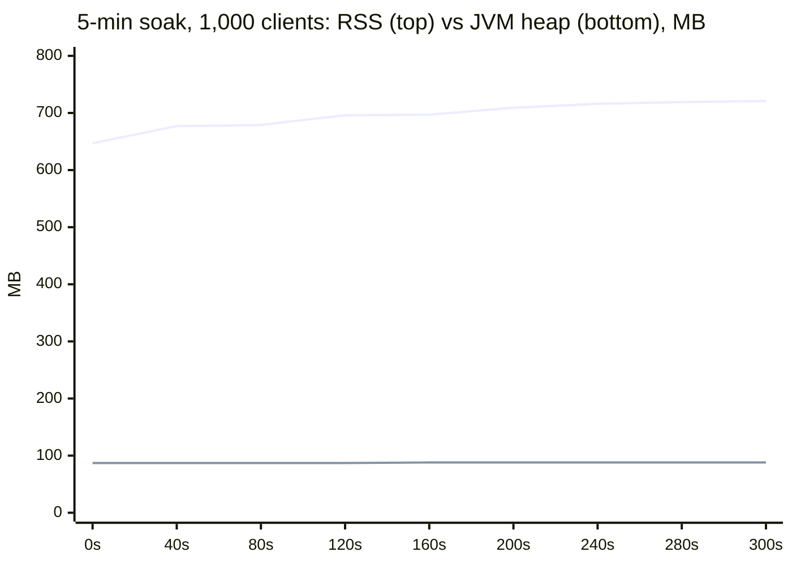
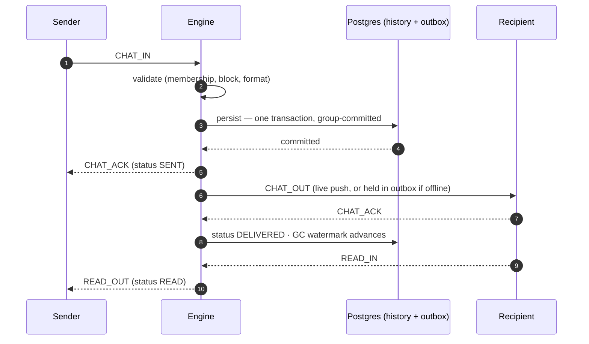
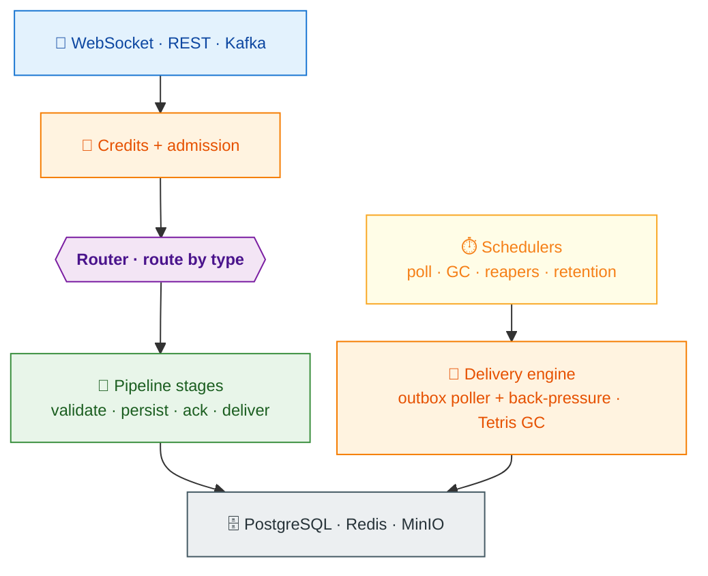

<div align="center">

# Hormigas Messenger

**A reactive message-delivery engine for two-party marketplaces.**
Real-time chat, attachments, presence and WebRTC signaling — where every chat message
is committed to durable storage *before* it is acknowledged, and never lost after that.

Java 25 · Quarkus 3.32 · Mutiny · PostgreSQL · Redis


[Quick start](#quick-start) · [Guarantees](#delivery-guarantees) · [Performance](#performance) ·
[Architecture](#architecture) · [Client contract](docs/CLIENT-CONTRACT.md)

</div>

---

## What is Hormigas?

Hormigas is a self-hosted messaging backend built for one job: reliable conversations
between two parties of a transaction — a client and a service provider negotiating an
order. It was built for the Hormigas marketplace, but the domain layer is thin and
swappable: point its ports at any two-party or fan-out use case and the delivery
guarantees, back-pressure and garbage collection come along unchanged.

**Where it sits among the alternatives:**

| If you need… | Consider | Hormigas instead gives you |
|---|---|---|
| Ephemeral real-time fan-out (live scores, notifications) | Centrifugo, socket.io | Durable, ACK-tracked delivery: a message survives crashes, Redis wipes and offline recipients |
| A raw durable log | Kafka alone | Chat semantics on top of durability: receipts, presence, typing, attachments, per-message lifecycle |
| A full federated protocol | Matrix, XMPP | A small embeddable engine — no federation, no protocol committee, ~1 GB of RAM |

**When *not* to use it:** group chats (1:1 only in v1), multi-device fan-out per user
(single active session), or federation. See the [roadmap](#status--roadmap).

## Delivery guarantees

The contract is split explicitly between server and client — and every rule below is
verified against the code by e2e tests:

| The server guarantees | The client owns |
|---|---|
| A chat message is written to `history` + `outbox` in **one transaction before it is ACKed** — an acknowledged message is durable, full stop | **De-duplication** by `messageId` (delivery is at-least-once; rare duplicates are by design) |
| **At-least-once delivery**: offline recipients get held messages on reconnect; crashed deliveries are retried via leases | **Ordering** for display — re-sort by the server-assigned monotonic ULID |
| Receipts are **ACK-driven, never push-assumed**: `SENT → DELIVERED → READ` advance only on client confirmation | **History re-read over REST on every (re)connect** — that read-through closes any disconnect gap |
| GC **never over-trims**: only rows below the lowest un-ACKed id are reclaimed, and a Redis wipe triggers rehydration from the durable outbox | Prompt **ACKs** — an un-ACKed backlog past the limit gets the connection reaped |

Exactly-once is deliberately *not* a server goal — the client-side dedup makes it
unnecessary, and dropping that requirement is one of the reasons the engine is fast.
The precise semantics, failure cases included: **[STORAGE](docs/STORAGE.md)**.

## Quick start

```bash
git clone https://github.com/Lindenson/HormigaMessanger.git
cd HormigaMessanger

# 1. Backends — Postgres + Redis + MinIO
docker compose -f e2etests/docker-compose.yml up -d

# 2. Build (JDK 25) and run the prod-profile jar against them, JVM memory-bounded
JAVA_HOME=/path/to/jdk-25 ./mvnw -DskipTests package
MALLOC_ARENA_MAX=2 DB_HOST=localhost REDIS_HOST=localhost MINIO_ENDPOINT=http://localhost:9000 \
  java -Xmx2g -XX:MaxDirectMemorySize=1g -XX:MaxMetaspaceSize=256m -XX:ReservedCodeCacheSize=256m \
       -jar target/quarkus-app/quarkus-run.jar         # → :8080
```

`./mvnw test` runs the unit/integration suite (Quarkus Dev Services provisions Postgres/Redis in
containers automatically). Then open Swagger UI at `http://localhost:8080/q/swagger-ui` and connect a
WebSocket client to `/ws` (see the [frame examples](docs/API.md#websocket-protocol)). Full bring-up
order, dependencies and the memory bounds: **[DEPLOYMENT](docs/DEPLOYMENT.md)**.

> **Production requires the Ory edge.** The service trusts proxy-injected `X-User-*`
> headers and does not validate JWTs itself — a directly exposed port lets anyone forge
> `X-Role: ADMIN`. Bring-up order, dependencies and hardening: **[DEPLOYMENT](docs/DEPLOYMENT.md)**.

## Performance

All figures are measured by a Gatling harness over **real WebSockets**, and a message
is counted only after its **database commit + `SENT` ACK** — a counted message is a
persisted one. Everything (app, load generator, Postgres, Redis, MinIO) shares a
single host, so these numbers are a **floor**, not a ceiling.

| Scenario | Load | Latency (send → SENT) | Loss | Memory |
|---|---|---|---|---|
| **Realistic soak** — 1,000 WS clients, 500 conversations, human think-time, 30% reconnect churn, 5 min | ~39.5k messages | mean 4 ms · p95 13 ms · p99 19 ms | **0** server-side drops | heap flat at ~88 MB, RSS ~0.72 GB, **0 full GC** |
| **End-to-end ceiling** — many paced connections, persisted + delivered + ACKed | **~3,000 msg/s sustained** | p95 20 ms | **0** loss, 0 full GC | DB pool ~95% idle, CPU 7–13% |
| **Ingest ceiling** — persist path at full rate (delivery deferred to store-and-forward) | **~4,000 msg/s committed** (~4,600 peak) | ACK < 1 ms · max 39 ms | **0** (0 KO of 1.26M ops) | JVM bounded, ~0.9 GB resident |
| **Abuse test** — 1,200 clients, rotating flooders at 10× their rate limit | waves of 50→100→75% abusers | excess refused at ingress with a retryable notice | **0** silent losses | server CPU ~0.6% |

The end-to-end and ingest ceilings measure different things — the ingest run commits
everything durably but defers most live delivery to the outbox; the distinction is
spelled out in [PERFORMANCE §4](docs/PERFORMANCE.md#4-ingest-ceiling--persist-path-at-full-rate).

The memory curve is the signature of a leak-free service — it climbs to its working
set in ~90 s and stops:



Full methodology, scaling curve and a one-command reproduce recipe: **[PERFORMANCE](docs/PERFORMANCE.md)**.

## How a message lives



Every message type declares its own lifecycle — **the type you send is the contract
for how long it lives**:

| Strategy | Persisted | Retried until ACK | Survives restart | Used for |
|---|---|---|---|---|
| **Persistent** | ✔ (history + outbox) | ✔ | ✔ | chat messages, attachments |
| **Fire-and-forget** | ✘ | ✘ | ✘ | typing, presence |
| **Must-arrive** | transient draft | ✔ (dead-letter, retract-on-ACK) | ✔ until confirmed | system notices |
| **Signaling** | ✘ | ✔ | ✘ | WebRTC call setup |

## Features

- **Persistent 1:1 chat** with ACK-driven `SENT → DELIVERED → READ` receipts
- **Attachments** — two-phase presigned upload straight to MinIO/S3, delivered as a chat message
- **WebRTC signaling** relay, **typing** indicators, **presence** join/leave events
- **Must-arrive system notices** — dead-letter draft, retracted on client ACK; no loss, no duplicates
- **Evidentiary freeze** — when the parties reach a contract, that order's messages become immutable proof of the negotiation, on their own long retention
- **Delete-for-me** (per-side, reversible) and mutual **block** — the only messaging stop
- **Anti-impersonation** (the server owns sender/recipient on every frame), per-connection credit buckets, per-caller REST rate limits, single active session, admin console
- **Dual triggers** — create-chat and freeze are single core use-cases driven interchangeably by REST *and* a Kafka `order.events` consumer

## Architecture

A strict hexagonal core: the domain is framework-free, the engine talks to the world
through ports only, and adapters are replaceable. Every inbound message flows through
one pipeline assembled per message type — there is exactly one crossroads.



This isn't aspirational: **22 ArchUnit rules run in the build** and fail it on any
layering, naming or dependency violation — the design cannot quietly rot. The full
module map, the routing matrix and the rules: **[ARCHITECTURE](docs/ARCHITECTURE.md)**.

### Why it's fast on 1 GB of RAM

Four load-bearing decisions, each measured in [PERFORMANCE](docs/PERFORMANCE.md):

1. **Group-commit persistence.** Many inbound messages coalesce into one
   `history + outbox` transaction — the single biggest throughput lever. A rolled-back
   batch retries row-by-row, so one bad message fails alone.
2. **Per-connection credit flow control.** Each socket gets a token bucket; excess is
   refused at ingress with a retryable notice. Capacity scales with connections, not
   with any one client's rate — floods cannot reach the engine.
3. **Isolated database pools.** The persist writers and the outbox poller (with its
   GC) run on **separate** reactive pools, so a write burst can never starve live
   delivery. The poller claims batches with a single-statement `SKIP LOCKED` lease —
   one round-trip, multi-instance safe.
4. **Redis as a rebuildable cache.** Redis holds only reconstructible state; on a wipe
   the GC rehydrates from the durable outbox before trimming anything. An outage
   degrades to *slower*, never to *wrong*.

The "Tetris" GC deserves a note: per-recipient ACK ranges merge (Redis ZSET + atomic
Lua) into a global safe-delete watermark. The model is an ACK-range merge over
monotonic ids — storage-agnostic, so the outbox can move from Postgres to a
log-structured store (Kafka, an append log) without redesigning the GC.
Details: **[STORAGE](docs/STORAGE.md#watermark-gc-tetris)**.

## Building a client?

The division of labour is explicit: the server is authoritative on **durability and
authorization**; the client owns **ordering and de-duplication**. The six rules:

1. **ACK everything you receive** — receipts and GC advance only on your ACKs.
2. **De-dup by `messageId`**, re-sort by it for display (it's a monotonic ULID).
3. **Re-read history over REST on every (re)connect** — that closes the gap.
4. Answer the server's **ping** within the idle timeout or be disconnected.
5. **One session per identity** — a new connection evicts the old one.
6. Respect **credits and `429`s** — back off and retry.

The full contract, every rule verified against the code: **[CLIENT-CONTRACT](docs/CLIENT-CONTRACT.md)** ·
wire protocol and endpoints: **[API](docs/API.md)**.

## Technology

| Layer | Technology |
|---|---|
| Runtime | Java 25, Quarkus 3.32 (`websockets-next`) |
| Reactive | Mutiny end to end; Vert.x reactive PostgreSQL & Redis clients — no thread-per-request anywhere |
| Durable store | PostgreSQL + Flyway migrations |
| Cache / shared state | Redis (presence, idempotency, watermarks) |
| Objects | MinIO (S3-compatible), presigned URLs |
| Events | Apache Kafka (SmallRye) — inbound `order.events` |
| Identity | Ory Kratos + Oathkeeper at the edge |
| Observability | Micrometer → Prometheus (`messenger_*` catalog), structured logs with MDC correlation, Grafana dashboard — [OBSERVABILITY](docs/OBSERVABILITY.md) |
| Quality | 417 unit/integration tests · Karate + WebSocket e2e suites · Gatling load harness · 22 ArchUnit rules — [TESTING](docs/TESTING.md) |

Configuration is fully env-parameterised and **validated at startup**: a mis-set knob
fails the boot with the complete list, never a silent under-load surprise. Every key
carries an inline tuning hint — **[CONFIGURATION](docs/CONFIGURATION.md)**.

## Status & roadmap

| | |
|---|---|
| ✅ **Done & tested** | Full chat lifecycle, offline delivery, receipts, freeze & retention, attachments, signaling, system notices, Kafka adapter, presence, flow control, admin console, graceful shutdown, observability |
| 🔜 **Next** | Per-conversation server ordering (client re-sorts today) · deliver-live-on-commit · OPS hardening (TLS, alerts, WS-resume) |
| 🗺️ **Designed for, not built yet** | Horizontal sharding (the outbox is already multi-instance safe), Redis cluster, Postgres sharding, MinIO→S3 — [why it shards](docs/STORAGE.md#why-it-shards-without-a-rewrite) |

Functionally complete on a proven performance envelope; remaining work is operational
hardening and a staged rollout behind the Ory edge.

## Documentation

| Page | What's inside |
|---|---|
| [CLIENT-CONTRACT](docs/CLIENT-CONTRACT.md) | The integration contract — ACKs, dedup, reconnect, sessions, flow control |
| [API](docs/API.md) | WebSocket protocol, REST endpoints, Kafka envelope |
| [STORAGE](docs/STORAGE.md) | History/outbox, delivery engine, Tetris GC, guarantees, sharding |
| [ARCHITECTURE](docs/ARCHITECTURE.md) | Hexagonal layering, the pipeline, enforced rules |
| [PERFORMANCE](docs/PERFORMANCE.md) | Method, results, memory profile, reproduce recipe |
| [CONFIGURATION](docs/CONFIGURATION.md) | Env vars, tunables, limits, trade-offs |
| [DEPLOYMENT](docs/DEPLOYMENT.md) | Dependencies, bring-up order, scaling |
| [OBSERVABILITY](docs/OBSERVABILITY.md) | Metric catalog, logging, dashboard |
| [TESTING](docs/TESTING.md) | Unit, e2e, load, ArchUnit — and how to run them |

## License

© 2026 Lindenson. Licensed under **[CC BY-NC-ND 4.0](LICENSE)** — you may share it **with attribution to
the developer**, but **not use it commercially** and **not distribute modified versions**. Commercial use
or derivative works require the developer's prior written permission. Full terms: [LICENSE](LICENSE).
