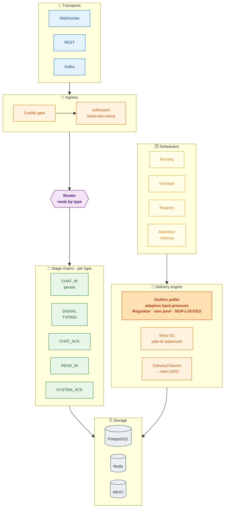

# Architecture — rules & patterns (the canonical style)

This is the **binding architectural specification** for HormigaMessanger, reverse-engineered from the
original engine at commit `04a2f70a` (the design that predates the feature work). It is the style the
codebase **must** follow. The enforceable subset is encoded in
`src/test/java/org/hormigas/ws/arch/HexagonalArchitectureTest.java` (ArchUnit, build-time).

> **Governing principle:** these rules may only be **tightened**, never loosened or ignored. New
> features extend the engine by *reusing* these patterns — they do not invent new ones.

---

## 1. Layers (hexagonal)

```
domain/          framework-free models, value objects, invariants, validation contracts
core/            business/engine logic: pipeline, stages, router, poller, watermark, regulator,
                 presence, credits, garbage collector — orchestrates via PORTS only
ports/           driven/driving contracts (interfaces) — the only thing core knows of the outside
infrastructure/  adapters that implement ports: postgres, redis, websocket, rest, kafka, minio, ...
config/          top-level: configuration mappings (MessengerConfig, ...)
scheduler/       top-level: @Scheduled entry points that drive core loops
```

**Dependency direction (enforced):**
- `domain` depends on nothing framework-heavy (see §5) and on no other layer.
- `core` depends on `domain` + `ports` only — **never** on `infrastructure`.
- `ports` depend on `domain` only — never on `core` or `infrastructure`.
- `infrastructure` implements `ports`; it may depend on `core`, `ports`, `domain`.

---

## 2. Ports, adapters & repositories — the abstraction rules

This is the most-violated area, so it is spelled out precisely.

### 2.0 Driving (port-IN) vs driven (port-OUT) — where each interface lives
- **Driving / inbound interfaces** (the core's *use-case API*, what the outside calls IN) live in
  **`core`**, alongside their implementation — e.g. `core/router/InboundRouter` (← `MessageInboundRouter`),
  and the use-case interfaces `core/conversation/Chats` (← `Conversations`), `core/attachment/Uploads`
  (← `Attachments`), `core/notify/Notices` (← `SystemNotifier`). They are **not** in `ports/`.
- **Driven / outbound ports** (what the core needs FROM the outside) live in **`ports/`** — e.g.
  `OutboxManager`, `History`, `ConversationManager`, `AttachmentManager`, `ObjectStorage`. Implemented
  by infrastructure adapters.
- **Adapters depend on abstractions, never on concrete core.** A driving adapter (REST/Kafka/WS) injects
  a core **interface** (Chats/Uploads/Notices) or a driven port — never a concrete core use-case class.
  Enforced: `rest_and_messaging_adapters_depend_on_abstractions_not_concrete_core`. (Engine-composition
  infra — e.g. `InboundPublisher` wiring `WithBackpressure` — may reference concrete core engine pieces;
  the rule targets the REST/Kafka business adapters.)
- **Result/value types are `domain`**, never nested in a port or core class — e.g. `domain/conversation`
  (`Guarded`, `Outcome`, `CreateResult`, `SendCheck`, `SendDecision`), `domain/attachment`
  (`UploadResult`, `ConfirmResult`, `DownloadResult`, `UploadTicket`, `UploadStatus`), `domain/storage`
  (`PresignedUrl`). Mirrors the baseline (`StageResult`, `ValidationResult`, `MessageEnvelope` are domain).

### 2.1 A port is a role, named by capability — never by mechanism
Driven ports are **interfaces** in `ports/<capability>/`, named for the *role* they play, using nouns like
`*Manager`, `*Registry`, `*Channel`, `*Directory`, or a plain capability noun:

```
ports/outbox/OutboxManager        ports/history/History         ports/presence/PresenceManager
ports/tetris/TetrisMarker         ports/channel/DeliveryChannel ports/session/SessionRegistry
ports/idempotency/IdempotencyManager  ports/identity/ClientDirectory  ports/notifier/Coordinator
ports/watermark/WatermarksRegistry
```

- **A port name must NEVER contain "Repository", "Adapter", or a technology** (`Postgres`, `Redis`,
  `Kafka`, …). "Repository" is an *implementation-internal* concept and must not leak into the port
  layer. (Counter-example to fix: `ports/conversation/ConversationRepository` — wrong; the port should
  be a role noun, e.g. `Conversations`/`ConversationStore`/`ConversationRegistry`, and "repository"
  stays inside `infrastructure`.)
- Ports are interfaces (nested records/enums for their own DTOs are fine).

### 2.2 Two implementation shapes — pick by mechanism

**(a) Direct adapter** — for caches, in-memory stores, stubs and live transports: a single
`infrastructure` class implements the port directly, named `<Tech><Role>`:
```
PresenceManager      ← RedisPresenceManager
TetrisMarker         ← RedisTetrisMarker
IdempotencyManager   ← RedisIdempotencyManager        (or IdempotencyManagerInMemory)
ClientDirectory      ← StubClientDirectory
SessionRegistry      ← WebSocketSessionRegistry
DeliveryChannel      ← Deliverer
```

**(b) Adapter + Repository (two-level)** — for SQL/relational persistence: an **adapter** implements
the port and owns the **domain↔DTO mapping**; it delegates raw SQL to a **repository** that is
*entirely internal to infrastructure*:
```
OutboxManager (port)
   ← infrastructure/persistance/postgres/outbox/OutboxPostgresAdapter     (implements port, maps Message↔DTO)
       → infrastructure/persistance/postgres/OutboxRepository             (infra-internal interface — the "repository")
           ← infrastructure/persistance/postgres/outbox/OutboxPostgresRepository  (raw SQL)
History (port)
   ← .../history/HistoryPostgresAdapter → .../HistoryRepository ← .../history/HistoryPostgresRepository
```
- **Layout = one subpackage per aggregate.** The adapter and its SQL repository impl live **together** in
  the aggregate's subpackage (`.../outbox/`, `.../history/`, `.../conversation/`, …). There is **no
  catch-all `adapters/` folder** — an adapter is a single-aggregate port impl, so it belongs beside the
  repository it drives (enforced: `postgres_adapters_live_in_their_aggregate_subpackage`).
- The repository **interface deliberately sits at the persistence-tech root**
  (`infrastructure/persistance/postgres/`); its SQL impl in the aggregate subpackage. This is intentional
  — do **not** "fix" it by moving the interface into the subpackage.
- A **shared** mapper that serves more than one aggregate (e.g. `MessageMapper` maps `Message` for both
  outbox and history) stays in the neutral `mappers/` package (interface `OutboxMapper` at the root, like
  the repositories) — putting it in one aggregate's folder would create an aggregate→aggregate dependency.
- **"Repository" types live only in `infrastructure`** and are referenced **only by their adapter** —
  never by `core` or `ports`. Core talks to the *port*; the repository is invisible to it.

### 2.3 When core uses a port directly vs. through more layers
Core always talks to a **port**. The port may be backed by a direct adapter (a) or an
adapter+repository (b) — that choice is an infrastructure detail core never sees. A REST adapter may
likewise call a port directly for a **simple** read (e.g. `MessageHistoryResource → History`); what is
forbidden is putting **business/domain decisions** in the adapter (see §4).

---

## 3. Naming conventions

| Layer / kind | Convention | Examples |
|---|---|---|
| **Core class** | role noun; **NEVER the `Service` suffix** | `OutboxPoller`, `TetrisWatermark`, `FeedbackRegulator`, `MessageInboundRouter`, `OutboxGarbageCollector` |
| Core capability + variants | interface (role) + `Async*` decorator + concrete impl | `Watermark` → `AsyncWatermark` → `TetrisWatermark`; `Poller` → `AsyncBatchPoller` → `OutboxPoller` |
| **Port** | role noun interface; no `Repository`/`Adapter`/tech | `OutboxManager`, `DeliveryChannel`, `ClientDirectory` |
| **Adapter** (direct) | `<Tech><Role>` | `RedisPresenceManager`, `StubClientDirectory` |
| **Adapter** (SQL) | `<Aggregate><Tech>Adapter` | `OutboxPostgresAdapter`, `HistoryPostgresAdapter` |
| **Repository** (infra-only) | `*Repository` / `<Aggregate><Tech>Repository` | `OutboxRepository`, `OutboxPostgresRepository` |
| REST resource | `*Resource` in `infrastructure/rest/...` | `MessageHistoryResource`, `PresenceResource` |
| Domain validator | `Validator` (contract) + impl in `domain/validator` | `Validator`, `MessageValidator` |

> The `Service` suffix is specifically rejected for core classes: core is named by what a thing **is**
> (a poller, a watermark, a router), not generically "a service".

---

## 4. The inbound flow (and why WebsocketService is thin)

The transport adapter is **pure infrastructure**. The original `WebsocketService` does only:
deserialize the frame → apply the synchronous **filter** (a dependency: `ChannelFilter` /
`InboundMessageFilter`) → run the domain **validator** → `publish` to the `InboundPublisher`.

```
WebSocket frame
  → WebsocketService (infra: deserialize + sync filter + validate + publish)   ← NO db, NO use-cases
  → InboundPublisher (backpressure publisher)
  → MessageInboundRouter / MessagePipelineResolver (route by MessageType → PipelineType)
  → stages (Outbox, Delivery, Ack, Cache, Tetris, ...) — the use-cases / engine work
```

**Rules:**
- **The router is the single crossroads and pipeline for every message — the only one.** All routing
  and message handling go **through the publisher → pipeline**, keyed by `MessageType` in
  `MessagePipelineResolver`. **Every** inbound type is handled by a pipeline (e.g. `CHAT_ACK →
  ACK_PERSISTENT`). A new inbound type (e.g. `READ_IN`, `SYSTEM_ACK`, `TYPING_IN`) gets a `PipelineType`
  + a stage — it is **not** handled inline in the WS adapter. Corollaries:
  - **Delivery to a client happens only inside the pipeline** (`DeliveryStage` / `ReadStage`). No
    adapter and no other core code delivers a message directly. *(Enforced:
    `message_delivery_flows_only_through_the_router`.)* Sole transport-level exception:
    `WebsocketService.notifyOverloaded` — the ingress-reject signal fired when the router's own queue is
    full, which by definition cannot use the saturated pipeline (raw socket write, not `DeliveryChannel`).
  - **A message that is persisted is written to the database only in batch** (group-commit —
    `InboundPersistBatcher` for `CHAT_IN`, the read-status batcher for `READ_IN`), never row-by-row on
    the hot path.
  - **A transient message (e.g. `TYPING`) still routes** — through the pipeline to live delivery — but
    is **not persisted** (the `SIGNAL_IN → INBOUND_CACHED` shape: send-guard + cached delivery).
- A pre-processing concern that must run before publish is a **filter** the adapter depends on
  (the `ChannelFilter` pattern) — not inline business code, and not a DB call in the adapter.
- The WS adapter may translate transport authentication (e.g. stamp the authenticated sender id from
  the session onto the message) — that is adapter responsibility, with **no DB access**. Membership /
  block / recipient-resolution / read-receipts / system-ack are **use-cases**, done downstream in the
  pipeline, never in the adapter.

### Module map — how the core modules interact

Every inbound frame is metered at the edge, routed once by type, and carried through a per-type stage
chain; delivery, GC and storage are separate cooperating modules around that spine.

Two flows meet at storage. **Left spine — ingest:** a frame is metered, routed once by type, and carried
through a per-type stage chain that persists to the outbox. **Right — the scheduled delivery engine:**
timer-driven loops drain the outbox and reclaim it; the **back-pressure lives here, on the poller** (its
adaptive Regulator throttles the drain), not at the entrance.



<sub>Ingest spine (left): 🔌 transports → 🚧 credits + admission → **Router** (single crossroads) →
🧩 per-type stage chains → persist to 🗄️ storage. Scheduled engine (right): ⏱️ **Schedulers** drive the
🚚 delivery engine — **Routing** → outbox poller (which carries the adaptive **back-pressure**),
**Garbage** → Tetris GC, **Reapers** → presence, **Retention/cleanup** → storage sweeps.</sub>

### The routing matrix — one crossroads, many paths

`MessagePipelineResolver` maps every `MessageType` to a `PipelineType`, and each `PipelineType` is a fixed
ordered stage chain. The type *is* the route:

| Type | → PipelineType | Stage chain (essence) | Persisted |
|---|---|---|:---:|
| `CHAT_IN` | `INBOUND_PERSISTENT` | Authorization → Outbox (group-commit) → Ack `SENT` → TetrisSent → Delivery | ✔ |
| `SIGNAL_IN`, `TYPING_IN` | `INBOUND_CACHED` | Authorization → Cache → Delivery (live, transient) | ✘ |
| `PRESENT_*` | `INBOUND_DIRECT` | direct presence handling | ✘ |
| `CHAT_ACK` | `ACK_PERSISTENT` | TetrisAck → status `DELIVERED`, advance the safe-delete watermark | — |
| `SIGNAL_ACK` | `ACK_CACHED` | cache-ack | — |
| `READ_IN` | `READ` | ReadStage → mark `READ` + push `READ_OUT` | status |
| `SYSTEM_ACK` | `ACK_SYSTEM` | retract the dead-letter draft | — |
| `CHAT_OUT` · `SIGNAL_OUT` · `TYPING_OUT` | `OUTBOUND_CACHED` | cache (dedup) → deliver | ✘ |
| `SERVICE_OUT` | `OUTBOUND_DIRECT` | deliver | ✘ |
| `SYSTEM_OUT` | `OUTBOUND_TRANSIENT` | eager dead-letter draft → deliver (retract on `SYSTEM_ACK`) | draft |

### Core modules (all in `core/`, framework-free of transport)

- **Credits** (`core.credits`) — a per-connection token bucket (`LazyCreditsBucket`) checked by
  `InboundMessageFilter` *before* publish; an exhausted bucket refuses the frame at ingress (the
  flood/abuse guard). Aggregate capacity ≈ connections × refill, never one client's rate.
- **Admission & shedding** (`core.backpressure`) — the in/out publishers are bounded emitters
  (`BUFFER` + a `queue-size` gate); over the gate a send is shed and the sender gets a `SERVICE_OUT`
  overload notice. The inbound publisher runs **PARALLEL** so many `routeIn` flows are in flight at once
  (which lets the persist batcher fill a batch). This is admission control at the edge — distinct from the
  poller's back-pressure below.
- **Group-commit batchers** (`core.batch`) — `InboundPersistBatcher` (CHAT) and `ReadStatusBatcher`
  (READ) over a generic `GroupCommitBatcher`: coalesce concurrent writes into one transaction, several in
  flight; a timed group drains through `onOverflow().invoke(shed).drop()` so the flush never
  `BackPressureFailure`-stalls (the load-test lesson).
- **Outbox poller + adaptive back-pressure** (`core.poller.outbox`, `core.feedback`) — a poller (driven by
  the Routing scheduler) claims a batch in one `SKIP LOCKED` statement on its **own DB pool**. **This is
  where the system's back-pressure lives:** the adaptive `Regulator` grows the poll interval on drops and
  decays it when stable — the drain throttles itself, no manual tuning. Not an ingress concern.
- **Tetris GC** (`core.watermark.tetris`, `core.garbage`) — merges per-recipient ACK ranges (Redis ZSET +
  Lua) into the global safe-delete id; the collector (driven by the Garbage scheduler) deletes
  `outbox < safe`, and rehydrates from the Outbox if Redis was wiped. See
  [STORAGE](STORAGE.md#watermark-gc-tetris).
- **Schedulers** (`scheduler/`, top-level `@Scheduled` drivers of the core loops) — **Routing** ticks the
  outbox poller; **Garbage** ticks the Tetris watermark GC sweep; **SessionLiveness** runs the liveness +
  overload **reapers** (force-disconnect, keep presence honest); **HistoryRetention**, **DeadLetterCleanup**
  and **AttachmentCleanup** run their retention/reclaim sweeps. They only *drive* — the work lives in core.
- **Presence** (`core.presence`) — Redis-backed online state gating *live-delivery attempts* only;
  kept honest by the reapers. It is a correctness dependency of GC, never its truth.
- **Storage ports** (`ports/*` → `infrastructure/*` adapters) — History/Outbox on Postgres (per-aggregate
  adapter + repository), Redis, MinIO; the core sees only role-noun ports.

---

## 5. Domain

- Domain types are POJOs/records carrying invariants and validation. Validation (the `Validator`
  contract + rules) **belongs in `domain/validator`**.
- Framework-free: domain must not depend on `io.quarkus`, `io.vertx`, `jakarta.ws`, persistence,
  Kafka, MinIO, or `infrastructure`. **Accepted (baseline-faithful) compromises:** Jackson annotations
  on the wire `Message`, and CDI scope/inject annotations (`jakarta.enterprise`/`jakarta.inject`) —
  the original domain `MessageValidator` is a `@ApplicationScoped` bean, so validation stays in
  `domain/validator` and the domain may carry CDI annotations. (This restores the baseline; the earlier
  "no `jakarta.enterprise` in domain" rule was a post-baseline over-tightening that wrongly pushed the
  validator into `infrastructure`.)
- **Known baseline smell (documented, not enforced):** `domain.session.ClientSession` references
  `core.credits.Credits` (domain→core). This predates the feature work; the `domain` rule deliberately
  does not forbid `core`/`ports` so as to encode the architecture *as it is* rather than be stricter
  than it. Candidate to decouple later (e.g. move `Credits` to domain), not a regression to chase now.

---

## 6. Enforced ArchUnit rules (build-time)

`HexagonalArchitectureTest` — **22 rules, all green** (baseline locked + restoration complete):

*Layering:* `domain` framework-free & infra-independent · `core` not → `infrastructure` · `core` free
of transport/persistence tech (vertx, jax-rs, persistence, kafka, minio, lettuce) · `ports` not →
`core`/`infrastructure`.
*Naming:* no `*Service` in `core` · `ports` are interfaces.
*Ports/adapters/repositories:* `*Repository` only in `infrastructure` · `core`/`ports` don't depend on
`*Repository` · `*Adapter` only in `infrastructure` · `*Mapper` only in `infrastructure` · a
`*PostgresAdapter` lives in its aggregate subpackage, not a catch-all `postgres/adapters/` folder (§2.2) ·
no package named `repository` in `core`/`ports`/`domain` (it's an infra-internal concept — §2.1).
*Transport annotations only in their slice:* `@Path`/`*Resource` → `infrastructure.rest` · `@WebSocket`
→ `infrastructure.websocket` · `@Incoming` → `infrastructure.messaging` · `@Scheduled` → `scheduler`.
*Adapter purity:* `WebsocketService` ingress is pure transport · `infrastructure` makes no domain
decisions (`Conversation.hasParticipant`/`isBlocked`).
*Single message pipeline:* client delivery (`DeliveryChannel.deliver`) is invoked only from
`core.router..` — the router is the one crossroads for all messages (§4).
*Validation:* `Validator` implementations reside in `domain`.

### Restoration — DONE (all 22 rules green)
The drift that prompted these rules has been remediated:
- `MessageValidator` moved back to `domain/validator` (domain may carry CDI scope annotations — §5).
- Driven-port renames: `*Repository` ports → `*Manager` (`ConversationManager`, `AttachmentManager`);
  "Repository" stays inside `infrastructure`.
- Core use cases renamed off `Service`: `Conversations`, `Attachments` (and `SystemNotifier`).
- Driving interfaces `Chats` / `Uploads` / `Notices` live in **core** (§2.0), implemented by the core
  use cases; result/value types are **domain** types.
- `ChatResource` and the WS ingress no longer make domain decisions: membership/recipient resolution,
  `READ_IN` and `SYSTEM_ACK` moved into pipeline stages (`AuthorizationStage`, `ReadStage`,
  `SystemAckStage`; new `PipelineType`s `READ` / `ACK_SYSTEM`). `WebsocketService` is pure transport.
- REST/Kafka adapters depend on abstractions, not concrete core (`rest_and_messaging_adapters_…`).

Verified: 323 unit (incl. all ArchUnit rules) + 30 e2e (20 Karate REST + 10 WS) green.

## 7. Conversation model & the dual-driven principle

- **A conversation is the pair `(clientId, masterId)`** (two Ory identities). **1:1 only, no groups.**
- **Order-agnostic** — **one conversation per pair, reused across orders.** The messenger never
  models/branches/groups by order; the `orderId` travels only as **opaque metadata** set at creation.
  Grouping by order is a **frontend** concern.
- **Creation is service-to-service / admin only** — chats are provisioned by the platform, never by an end
  client. One idempotent core *create-chat* (idempotent on the pair → the existing chat is returned).
- **Dual-driven principle** — every event-capable operation (create-chat, freeze) is **one core use case**
  exposed via **two interchangeable inbound adapters**: a REST endpoint *and* the Kafka `order.events`
  consumer. Triggers are interchangeable; the use case is the mechanism. Both are live.
- Per-side **delete watermark** ("delete for me", reversible) and mutual **block** (the only messaging
  stop) are conversation invariants the send-guard/use-cases compose — see
  [CLIENT-CONTRACT](CLIENT-CONTRACT.md#delete-freeze--retention).

## 8. Project structure

```
domain/         message/ (Message, MessageType, Payload), conversation/ (Conversation + result types),
                attachment/, credentials/ (ClientData), presence/, generator/, stage/, validator/, storage/
core/           router/ (pipeline, stages, resolver, context), poller/outbox, garbage/collector,
                watermark/tetris, presence/clients, credits, feedback, backpressure, batch/,
                ratelimit, conversation/ (Conversations, Chats, AdminChats), attachment/ (Attachments, Uploads)
ports/          history, outbox, channel, presence, tetris, message (ReadReceipts, MessageModeration),
                idempotency, notifier, session, conversation (ConversationManager), attachment, emit, storage
infrastructure/ persistance/postgres (per-aggregate: outbox/, history/, conversation/, …; repos + adapters),
                cache/redis, websocket, rest, messaging (Kafka), storage/minio, security, lifecycle, generator
```

## 9. Glossary

| Term | Meaning |
|---|---|
| **Conversation** | The `(clientId, masterId)` pair; the unit of chat. 1:1, order-agnostic. |
| **Pipeline** | Per-type sequence of async stages: validate → persist → ACK → deliver → finalize. |
| **Outbox** | Live delivery buffer in Postgres; rows cleared once safely delivered. |
| **History** | Durable long-term message store (source of truth). |
| **Watermark** | The safe-delete boundary; Outbox rows below it are GC'd. |
| **Tetris** | ACK-range merge (Redis ZSET + Lua) computing the global safe-delete id. |
| **Leasing** | `FOR UPDATE SKIP LOCKED` + lease so instances don't double-process Outbox rows. |
| **Presence** | Redis-cached online/offline state; gates delivery and GC correctness. |
| **Freeze** | One-way, message-level, order-scoped immutability (contract evidence). |
| **ULID** | Time-monotonic message id; also the history page cursor. |
| **Strategy A/B/C/S** | persistent / fire-and-forget / retry-then-purge / signaling. |
| **Credits** | Per-connection WS token bucket (flood guard); aggregate ≈ connections × refill. |
| **Ory (Kratos/Oathkeeper)** | Identity; the edge injects the `X-User-*` headers the service trusts. |
