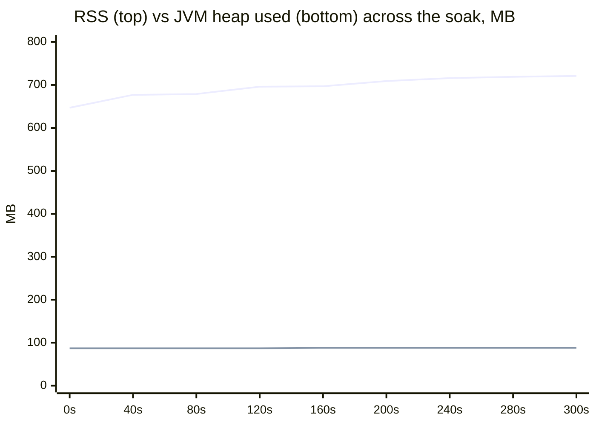
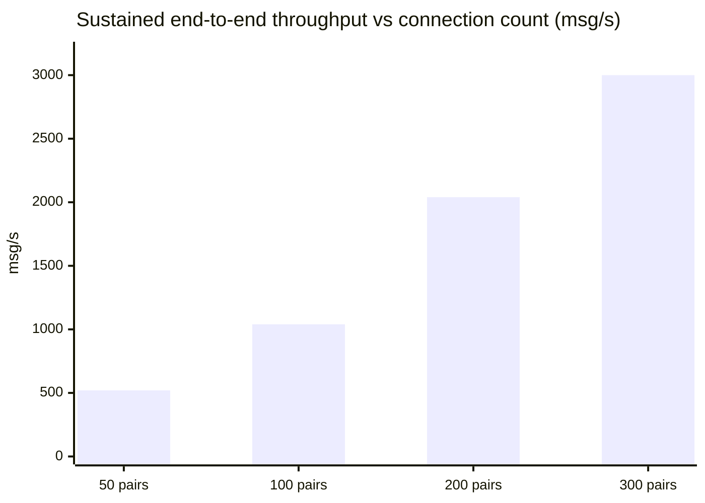

# Performance

This page is a benchmark report, not a brochure. Every scenario below states what it
measures, how, and what it does *not* prove. All raw numbers come from the Gatling
harness in [`loadtest/`](../loadtest) and are reproducible with
[one command](#reproducing-the-results).

## Summary

Four scenarios, four different questions:

| # | Scenario | Question it answers | Headline result |
|---|---|---|---|
| [1](#1-realistic-soak--1000-clients-human-pacing) | **Realistic soak** — 1,000 clients, human pacing, 5 min | How does real marketplace traffic feel? | p95 **13 ms** end-to-end, 0 drops, heap flat at 88 MB |
| [2](#2-flow-control-under-abuse) | **Abuse test** — 1,200 clients, rotating flooders | Can one client hurt the others? | No: excess refused at ingress, server CPU ~0.6 % |
| [3](#3-end-to-end-ceiling--paced-connections) | **End-to-end ceiling** — many paced connections | How much *delivered* traffic does it sustain? | **~3,000 msg/s** persisted + delivered + ACKed, p95 20 ms |
| [4](#4-ingest-ceiling--persist-path-at-full-rate) | **Ingest ceiling** — few unthrottled senders | How fast can the persist path alone go? | **~4,000 msg/s** committed, ACK latency below 1 ms |

Scenarios 3 and 4 measure **different things** — read the distinction in
[§4](#4-ingest-ceiling--persist-path-at-full-rate) before quoting either number.

## Methodology

**What counts as a message.** Every `CHAT_IN` is confirmed by the server's `SENT`
ACK, which is emitted only **after the database transaction commits**. A counted
message is therefore a durably persisted one — there is no way to inflate the numbers
with fire-and-forget frames.

**Transport.** Real WebSockets driven by Gatling — no mocks, no loopback shortcuts.
Latency is measured client-side, send → `SENT`.

**Environment.** A single host runs the application, the load generator, PostgreSQL,
Redis and MinIO simultaneously. The JVM is memory-bounded (see [Memory](#memory)).

**Known limitations** — read these before extrapolating:

1. **Single-host co-location.** The app competes with its own database and load
   generator for CPU and I/O. All figures are a *floor*; an off-box deployment has
   more headroom in every dimension.
2. **The load generator is the first thing to saturate.** In the high-rate runs the
   co-located generator (holding ~1,170 receiver sockets *and* fanning out thousands
   of msg/s) degraded before the server did — in §4 the online receiver count drifted
   from ~1,150 toward ~380 over the run, with only 8 server-side closes. Server-side
   throughput and persistence were unaffected, but the *live-delivery* figures in
   high-rate runs are bounded by the generator, not the server.
3. **Millisecond resolution.** Gatling reports latency in whole milliseconds. A
   reported p99 of "0 ms" means *below 1 ms as measured*, not literally zero.
4. **Config drift between runs.** Scenarios 2 and 3 were measured at the earlier
   credit defaults (burst 100, refill 10/s); the current defaults are 10× higher
   (burst 1000, refill 100/s). The mechanisms are unchanged; §4 is a run at the
   current defaults.

## Why it's fast — four levers

| Lever | What it does | Why it matters |
|---|---|---|
| **Group-commit persistence** | The inbound pipeline coalesces concurrent writes into one `history + outbox` transaction (`InboundPersistBatcher`), several batches in flight | Thousands of msg/s on a 20-connection DB pool — the single biggest throughput lever |
| **Per-connection credits** | Token bucket per socket (burst 1000, refill 100/s); excess is refused at ingress with a retryable `overloaded` notice | No client can flood the engine; aggregate capacity ≈ connections × refill, not any one client's rate |
| **ACK-after-commit** | `SENT` is emitted only after the DB commit | An acknowledged message is durable, full stop — never lost across a disconnect |
| **Bounded JVM** | `-Xmx2g` + capped direct/metaspace/code-cache + `MALLOC_ARENA_MAX=2` | Flat, predictable memory; virtual reservation drops from tens of GB to ~3.3 GB at zero throughput cost |

---

## 1. Realistic soak — 1,000 clients, human pacing

**Question:** how does the service behave under traffic shaped like production?

**Setup.** 500 chat pairs = 1,000 live WebSocket sessions, ramped over 30 s, held
5 minutes. Each pair holds a realistic marketplace conversation: participants take
turns with human think-time (1.5–7 s), the recipient marks each message read, message
bodies vary, and 30 % of clients drop, reconnect and re-sync history over REST
mid-run — the full client contract, exercised.

**Results.**

| Signal | Observed |
|---|---|
| Concurrent WS clients | 1,000, held 5 min |
| Messages persisted + delivered + ACKed | 39,535 — every one fully committed |
| Server-side drops | 0 |
| Send → `SENT` latency | mean 4 ms · p95 13 ms · p99 19 ms · max 91 ms |
| Errors (KO) | 40 (0.03 %) — all client-side: frames racing sockets the test itself closed for reconnect |
| DB pool utilisation | 0–1 of 20 connections active |
| GC | 0 full collections; 87 young pauses, 0.40 s total (~4.6 ms avg), 0.04 % overhead |
| Memory (heap / RSS / VIRT) | ~88 MB / ~0.72 GB / ~3.3 GB |

**Interpretation.** Human-paced load from a thousand users barely registers: the DB
pool is idle, latency is a fraction of a display frame and flat across the soak.
Memory climbs to its working set in ~90 s and stops — the signature of a leak-free
service:



---

## 2. Flow control under abuse

**Question:** can a misbehaving client degrade service for everyone else?

**Setup.** 1,200 clients online; a rotating subset of abusive senders each *attempts*
~100 msg/s — an order of magnitude above their per-connection refill — in three waves
(50 % → 100 % → 75 % of the abuser pool). Measured at the earlier defaults
(burst 100, refill 10/s); the mechanism is identical at the current defaults.

**Results.**

| Signal | Observed |
|---|---|
| Offered vs accepted | 924,800 frames offered → 322,107 accepted; the rest **refused at ingress** with an `overloaded` notice — a refusal the client retries, never a silent loss |
| Accepted throughput per wave | ~525 / ~1,050 / ~775 msg/s — tracks the wave shape exactly |
| Server CPU | ~0.6 % |
| Inbound queue drops | 0 — excess never reached the engine |
| GC / memory | 0 full GC; heap ~88 MB, RSS ~0.72 GB |

**Interpretation.** The credit gate does its one job: each connection is capped near
its refill rate, aggregate capacity scales with the number of connections, and the
engine behind the gate stays essentially idle while being firehosed.

### What happens past the gate — a bug found and fixed

Flow control is load-bearing, so we asked the uncomfortable question: what if it's
bypassed? We removed the limiter (a test-only override) and firehosed ~3,000 msg/s
from just 30 unthrottled connections.

**This surfaced a real defect.** The group-commit's timed flush emitted batches
ignoring downstream demand; when the concurrent-batch merge saturated, Mutiny raised
a `BackPressureFailure` that killed the persist stream — persistence collapsed to
zero at 2–3 % CPU. A backpressure-handling bug, not a resource limit.

**The fix** drains the batch group through `onOverflow().invoke(shed).drop()`: the
group always has demand and can never fail; genuine overflow sheds whole batches,
and every shed message completes as `FAILED` so its sender receives an `overloaded`
notice and retries. Shedding is loud, never silent.

**After the fix**, the same brutal regime — 10 minutes, 1,200 online, ~30 rotating
firehose senders in three waves — is a non-event:

| Signal | Before fix | After fix |
|---|---|---|
| Persistence | stalled at 341,501 rows | 1,324,500 rows, climbing steadily |
| Peak-wave throughput | 0 (stream dead) | ~3,025 msg/s, flat |
| `BackPressureFailure` | stream killed | 0 |
| Inbound queue drops | ~987k | 0 |
| Errors (KO) | — | 0 of 1,333,617 operations |
| CPU | 2–3 % (stalled) | 6–12 % |

Two conclusions worth stating plainly: the "stall" was purely a backpressure bug,
never a throughput wall — and the persist pipeline's own ceiling is comfortably above
3,000 msg/s even from 30 connections.

---

## 3. End-to-end ceiling — paced connections

**Question:** how much fully *delivered* traffic (persisted + delivered + ACKed) does
the engine sustain when reached the way the design intends — many connections, each
within its credit budget?

**Setup.** Chat pairs each awaiting the previous ACK before the next send (≤ the
per-connection refill), scaled from 50 to 300 pairs. Measured at refill 10/s; at the
current 100/s default the same ceiling needs proportionally fewer connections.

**Results.**



At 300 pairs: **~3,000 msg/s sustained for minutes**, p95 **20 ms**, zero loss, zero
full GC, DB pool ~95 % idle, CPU 7–13 %.

**Interpretation.** The scaling law is linear and by design:
**sustainable rate ≈ connections × refill rate** (300 × 10/s ≈ 3,000/s). Capacity
grows by adding connections or raising the refill — never by letting one client push
harder. For perspective: the realistic soak in §1 (≈130 msg/s of demand from 1,000
users) consumes about 4 % of this ceiling.

---

## 4. Ingest ceiling — persist path at full rate

**Question:** with the credit gate effectively lifted, how fast is the persist path
itself?

**This scenario measures ingest, not end-to-end delivery.** The 4,000 msg/s figure
below is the rate at which messages were *durably committed and ACKed to senders*.
Live delivery to recipients ran far behind (see the honest finding below) — quote
this number as a persist ceiling, never as chat throughput.

**Setup.** Current credit defaults (burst 1000, refill 100/s). 1,170 clients online;
40 rotating senders each firing ~100 msg/s at random peers, three waves
(50 % → 100 % → 75 %) over ~8 minutes. JVM memory-bounded; the outbox poller on its
own DB pool, isolated from the persist writers.

**Results.**

| Signal | Observed |
|---|---|
| Requests / errors (KO) | 1,255,709 / **0** |
| Persisted to DB | 1,245,199 rows |
| Credits exhausted · queue drops · persist failures · dead-letters | 0 · 0 · 0 · 0 |
| Send → `SENT` latency | p50/p95/p99 below 1 ms (0 ms at Gatling's resolution) · max 39 ms |
| Peak persist rate | ~4,112 msg/s over a 30 s window · ~4,600 msg/s instantaneous |
| Per-wave rate | ~2,000 / ~4,000 / ~3,000 msg/s — tracks the offered profile exactly |
| Memory | VIRT peak 3.3 GB · RSS 913 MB · flat, no leak |
| Live-delivered during the run | 135,853 |

**Interpretation.** Once the gate is lifted, the credit system is not the limiter:
the persist path commits everything it is offered at ~4,000 msg/s with sub-millisecond
ACKs on a bounded ~1 GB-resident JVM. The sub-millisecond figure is what
group-commit buys — an inbound message rides a batch that is already flushing.

**The honest finding: live delivery is the next ceiling.** Persistence outran
delivery — ~136k of 1.24M messages were pushed live during the run; the rest sat
durably in the outbox for store-and-forward on the recipient's next reconnect.
Nothing was lost (ACK-after-commit guarantees that), but *delivered* rate does not
yet match *persisted* rate at these extremes. Two caveats and one plan:

- The co-located load generator, not the server, was the practical cap on live
  delivery here (limitation 2 above).
- Isolating the poller onto its own DB pool already removed persist↔deliver
  contention.
- The next lever is **deliver-live-on-commit** for online recipients (poller for
  backlog only) — see the [roadmap](../README.md#status--roadmap).

### 20-minute sustained soak (release 0.0.1 evidence)

The same regime held for a full **20 minutes** (1,170 online, 40 rotating senders,
three 400 s waves 50 % → 100 % → 75 %):

| Signal | Observed |
|---|---|
| Requests / errors (KO) | **3,593,109 / 0** (100 % OK) |
| Persisted to DB | **3,565,052** rows · dead-letter 0 |
| Peak persist | ~4,085 msg/s (30 s window) · ~4,783 instantaneous |
| Drops · fails · credits-exhausted · inbound-drops | **0 · 0 · 0 · 0** |
| Backpressure shed | 148 (0.004 % — graceful shed-with-notice under the 100 % wave, never a stall) |
| Latency | p95 0 ms · p99 1 ms · max 178 ms |
| Memory | **VIRT constant 3.2 GB · RSS peak ~0.8 GB, flat across the run + idle tail — no leak** |

Nothing degraded over 20 minutes: memory stayed flat and bounded, latency stayed
sub-millisecond, and not one message was lost.

---

## Memory

By default a JVM *reserves* tens of GB of virtual address space (G1 heap region,
direct buffers, metaspace, code cache, thread stacks, mmap'd jars, up to
8 × cores glibc malloc arenas). That is a reservation, not RAM — only RSS costs
memory. The deployment bounds the reservation explicitly
(`docker-compose.yml`): `MALLOC_ARENA_MAX=2`, `-Xmx2g`,
`-XX:MaxDirectMemorySize=1g`, `-XX:MaxMetaspaceSize=256m`,
`-XX:ReservedCodeCacheSize=256m`.

| | Default JVM | Bounded |
|---|---|---|
| VIRT | ~24–33 GB | ~3.3 GB |
| RSS under load | ~2 GB | ~0.7–0.9 GB |
| Heap used | — | flat ~88 MB of the 2 GB cap |
| Full GC | — | 0 |
| Throughput / latency cost | — | none measured |

## Tuning

All knobs live under `processing.messages`, env-overridable, validated at startup:

| Param | Default | Effect |
|---|---|---|
| `credits.max-value` | 1000 | Per-connection burst allowance |
| `credits.refill-rate-per-s` | 100 | Per-connection sustained rate. **Aggregate ceiling ≈ connections × this.** Raising it weakens the abuse guard — change deliberately |
| `inbound.persist-batch.max-size` | 64 | Messages per transaction; higher → fewer commits, higher ceiling |
| `inbound.persist-batch.linger-ms` | 5 | How long a partial batch waits before flushing — the only latency batching adds |
| `inbound.persist-batch.max-concurrent-batches` | 8 | Batch transactions in flight. Keep ≤ the DB pool size |
| `redis.max-pool-size` / `max-pool-waiting` | 24 / 2048 | Sized for connection-churn storms (mass simultaneous disconnects) |

Full catalog with trade-offs: [CONFIGURATION](CONFIGURATION.md).

## Reproducing the results

Boot the app (prod profile) against Postgres + Redis + MinIO, then from `loadtest/`
(JDK 21):

```bash
# §1 — realistic conversation soak
mvn gatling:test -Dgatling.simulationClass=load.MessengerLoadSimulation \
    -Dload.users=500 -Dload.ramp=30 -Dload.duration=300

# §2 abuse / §4 ingest ceiling — online pool + rotating senders in waves
#   §4's ~4,000 msg/s run used pool=1170, activeFull=40 (40 talkers × ~100 msg/s):
mvn gatling:test -Dgatling.simulationClass=load.MessengerWaveSimulation \
    -Dload.pool=1170 -Dload.activeFull=40 -Dload.waveSec=140
```

Gatling writes an HTML report to `loadtest/target/gatling/`. Watch the server side
live at `/q/metrics` — `messenger_persist_batch_*`,
`messenger_outbound_published_total`, `messenger_inbound_dropped_total`,
`sql_pool_queue_delay_seconds_max` and the GC metrics tell the whole story
([OBSERVABILITY](OBSERVABILITY.md) has the full catalog).
