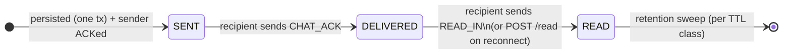
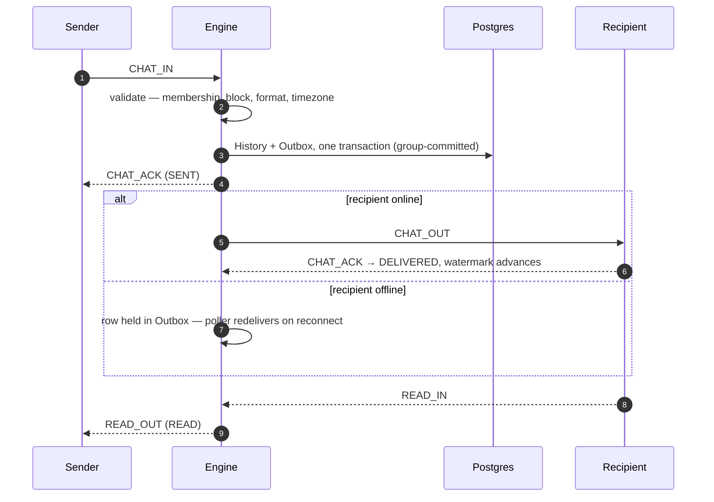

# Storage & delivery guarantees

How the messenger stores messages, delivers them, garbage-collects safely, and stays
correct when Redis is wiped — and why the design shards without a rewrite.

- [The guarantees, precisely](#the-guarantees-precisely)
- [Two stores: History and Outbox](#two-stores-history-is-truth-outbox-is-a-buffer)
- [Message lifecycle](#message-lifecycle)
- [The delivery engine](#the-delivery-engine--poll-lease-deliver)
- [Watermark GC](#watermark-gc-tetris)
- [Redis is a rebuildable cache](#redis-is-a-rebuildable-cache)
- [Idempotency](#idempotency)
- [Must-arrive notices](#must-arrive-notices-dead-letter)
- [Why it shards](#why-it-shards-without-a-rewrite)

## The guarantees, precisely

These five statements are the whole contract; everything below explains the
machinery behind them.

1. **A persistent chat message is never lost.** It is written to History + Outbox in
   one transaction *before* any ACK is sent — an acknowledged message is durable
   across crashes, restarts and Redis wipes.
2. **Delivery is at-least-once.** Offline recipients receive held messages on
   reconnect; crashed deliveries are retried via leases. Duplicates are possible by
   design; the client de-duplicates by `messageId`. Exactly-once is deliberately not
   a server goal.
3. **Receipts are ACK-driven, never push-assumed.** `SENT → DELIVERED → READ`
   advance only on explicit client confirmation — a WebSocket push proves nothing.
4. **GC never over-trims.** Only rows below the lowest un-ACKed id are reclaimed,
   and after a Redis loss the GC rehydrates its state from the durable Outbox before
   deleting anything.
5. **Ordering is best-effort on the server.** The client re-sorts by the
   server-assigned monotonic ULID for display
   ([CLIENT-CONTRACT](CLIENT-CONTRACT.md#ordering--de-duplication-are-the-clients-job)).

## Two stores: History is truth, Outbox is a buffer

| | `message_history` | `outbox` |
|---|---|---|
| Role | Single source of truth; REST reads it | Transient live-delivery buffer; the poller drains it |
| Lifetime | Retention TTL (frozen messages get a longer class) | Rows reclaimed once safely delivered |
| Can it lose a message? | Never, within retention | It may drop a live push before an offline recipient sees it — safe, because the row is already in History and the client re-reads history on reconnect |

Both rows are written in **one transaction**, so anything in the Outbox is already in
History. The invariant chain is: *persisted → visible via REST → eligible for GC* —
strictly in that order.

## Message lifecycle



`DELIVERED` means *ACK-confirmed* — a push is best-effort, so the status advances
only when the recipient acknowledges, and that same ACK advances the GC watermark.

The happy path in full:



### Persistence schema

Flyway migrations (`src/main/resources/db/migration`):

| Migration | Adds |
|---|---|
| `V2` | `message_history` + `outbox` (atomic insert) |
| `V3` | `conversation` — the `(client, master)` pair, JSONB metadata |
| `V4` | Per-participant hide / block flags |
| `V5` | `message_history.frozen` |
| `V6` | `message_history.status` (`SENT`/`DELIVERED`/`READ`) |
| `V7` | `message_history.order_id` + index — the key for order-scoped freeze |
| `V10` | Per-side delete watermarks (replacing the old boolean flags) |

Plus `dead_letter` (must-arrive drafts) and `attachment` (upload lifecycle). All keys
are Ory identity ids plus the ULID `message_id`; a conversation is keyed by its
`(client, master)` pair.

## The delivery engine — poll, lease, deliver

The internal engine has no message broker; the poller reads Postgres directly.

**Single-statement lease-and-claim.** One round-trip claims a batch and makes
multi-instance draining safe:

```sql
UPDATE outbox
SET    lease_until = now() + $lease,
       processing_attempts = processing_attempts + 1
FROM  (SELECT id FROM outbox
       WHERE lease_until <= now()
       ORDER BY id
       LIMIT $n
       FOR UPDATE SKIP LOCKED) picked
WHERE  outbox.id = picked.id
RETURNING …
```

`SKIP LOCKED` guarantees N instances never grab the same row; the lease guarantees a
crashed delivery is retried after it expires.

**Isolated pools.** The poller's reads, leases and GC run on a reactive datasource
pool *separate* from the persist writers — a write burst cannot starve live delivery.

**Adaptive back-pressure.** Under drops the poll interval backs off (a `Regulator`
feedback loop) and recovers on its own — the reader throttles itself instead of
hammering a stressed database.

## Watermark GC ("Tetris")

The GC deletes `outbox WHERE id < safe`, where `safe` is the lowest **un-ACKed** id
across all recipients. Computing it is a range merge — each ACK fills a cell, and a
fully-filled layer clears, hence the name.

State lives in Redis, mutated only by atomic Lua scripts:

| Key | Type | Holds |
|---|---|---|
| `tetris:re:<id>:ack` | ZSET | A recipient's unacknowledged message ids |
| `tetris:minids` | ZSET | Smallest pending id per client (score = id) |
| `tetris:re:cnt` | HASH | Pending count per client — heavy-client detection |
| `tetris:lastid` | STRING | Last globally seen id — forward progress |

Scripts run via `EVALSHA` with a `NOSCRIPT → EVAL` fallback (survives a script-cache
flush); startup cleanup uses `SCAN` + `UNLINK`, never the blocking `KEYS`. The safe
boundary advances on a **recipient ACK** or on **disconnect** — an offline client's
pending rows become collectable because they remain in History regardless.

**The model is storage-agnostic.** Tetris is an ACK-range merge over monotonic ids —
nothing about it is relational. Mapped onto a log-structured store, the outbox
becomes an append log (Kafka or a custom segment log), "delete below `safe`" becomes
advancing a committed offset or truncating sealed segments, and the per-recipient
ZSETs stay exactly as they are. The delivery engine can move off the Postgres outbox
without touching the GC logic.

### Presence is a correctness dependency of GC

The watermark advances on delivery, and delivery needs an *accurately* online
recipient — one phantom-online client would stall GC for everyone. Three mechanisms
keep presence honest:

- Presence (Redis) gates only live-delivery *attempts*; it is never the GC's source
  of truth — the watermark advances on ACK or connection close, both hard facts.
- A failed live push to an open session transitions the recipient OFFLINE, stopping
  phantom retries; the message simply holds in the Outbox.
- The server auto-pings; a connection silent past the idle timeout (35 s default) is
  force-closed, triggering presence and watermark cleanup. A transient false-offline
  is safe: the data is in History and the client recovers via REST on reconnect.

## Redis is a rebuildable cache

Redis holds only reconstructible state: presence, idempotency keys, Tetris
watermarks, the confirmed-notice set. Losing it — flush, cold start, crash — causes
no data loss and no incorrect GC:

- The GC is gated on a `tetris:primed` flag. When unprimed, it **rehydrates the
  pending set from the durable Outbox** before computing `safe` — it cannot advance
  past rows the cache forgot.
- Lua scripts self-heal via the `NOSCRIPT` fallback; cold-start cleanup is
  non-blocking.
- An outage degrades to "no live GC / presence" — messages still persist and deliver
  from Postgres. **Redis makes it fast; Postgres makes it correct.**

### On a Redis loss / reconnect — what recovers, and how

There is **no "Redis crashed/recovered" event** — and a reconnect is the wrong signal
anyway (Redis may restart with its data intact). Recovery is driven by **detecting
that state is gone**, on the regular sweeps:

- **Watermark (Tetris) — recovers itself.** The GC checks the `tetris:primed`
  sentinel every sweep (~10 s). If it is missing (Redis was wiped), the GC
  **rehydrates the pending set from the durable Outbox** before computing `safe`, so
  it can never over-trim. No manual action, no lost data.
- **Presence — self-heals from the local session registry.** Every instance, on a
  periodic sweep (`processing.session.presence-refresh-every`, default 30 s),
  **re-asserts its own live sessions into the shared presence set** (idempotent). So
  after any wipe the `/api/presence` view is rebuilt within one sweep. This is done
  per instance on purpose: each instance re-adds only *its* sessions, so it stays
  correct under **horizontal scaling** (no shared "primed" flag that one node could
  claim while others' sessions go missing).
- **Delivery & guarantees — unaffected.** Live delivery decides online/offline from
  the **in-process session registry**, not Redis presence; durability and ordering
  are Postgres-backed. So a Redis outage never loses, mis-delivers, or mis-orders a
  message — the only visible effect is a ≤ 30 s stale window on the who's-online view,
  which then self-corrects.

## Idempotency

- **Server:** best-effort dedup via a short-TTL Redis key per `messageId`, sized to
  absorb network, ACK-flush and scheduler latency.
- **Client:** the authoritative de-duplicator, by `messageId` — which is exactly why
  exactly-once is not a server goal
  ([CLIENT-CONTRACT](CLIENT-CONTRACT.md#ordering--de-duplication-are-the-clients-job)).

## Must-arrive notices (dead-letter)

System notices that must reach the recipient use a dedicated transient pipeline
backed by an **eager dead-letter draft**: the notice is written as a draft, pushed,
and the client's `SYSTEM_ACK` retracts the draft. If the recipient is offline, the
draft is held and redelivered on reconnect; a sweep drains confirmed drafts.
No loss, no duplicates — for exactly the messages that cannot afford either.

## Why it shards without a rewrite

- **Shared state is already centralized in Redis** (presence, Tetris, idempotency) —
  multiple app instances agree on GC and presence today.
- **Outbox claiming is `SKIP LOCKED` + lease** — N instances can drain the same table
  safely right now; a gateway shard key (`CRC32(clientId) mod N`) with per-instance
  outbox filtering scales it horizontally.
- **Postgres shards naturally by conversation** — a conversation is a self-contained
  pair, and every History/Outbox row carries the ids to route on.
- **Redis → cluster** (master/replica + Sentinel) is a drop-in: all access goes
  through the Vert.x client, the state is rebuildable, and Tetris keys are
  per-recipient so they hash-slot cleanly.
- **MinIO → sharded buckets or S3** is a config change — the service stores only the
  `objectKey` and mints presigned URLs on demand.

The staged path: [DEPLOYMENT](DEPLOYMENT.md#future-scaling).
